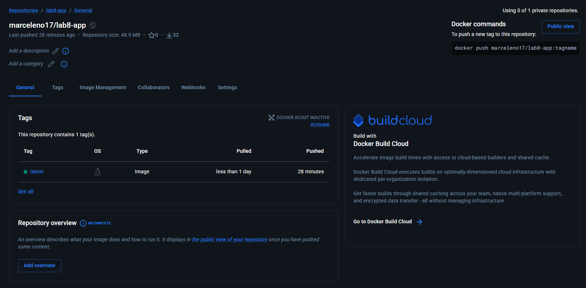

# Lab 8: Containerized Node.js and MySQL Stack Using Docker Compose

### 1) Clone the application code
```bash
git clone https://github.com/Ibrahim-Adel15/iVolveApp.git
cd iVolveApp
```

### 2) Create docker-compose.yml configuration
Create `docker-compose.yaml` specifying services, volumes, environment variables, and network:
```yaml
name: Lab8

services:
  app:
    image: myapp:latest
    build: iVolveApp
    ports:
      - 3000:3000
    environment:
      - DB_HOST=mysql
      - DB_USER=admin
      - DB_PASSWORD=admin123
    volumes:
      - app_logs:/app/logs
    networks:
      - ivolve-net

  mysql:
    image: mysql
    ports:
      - 3306:3306
    environment:
      - MYSQL_USER=admin
      - MYSQL_PASSWORD=admin123
      - MYSQL_DATABASE=ivolve
      - MYSQL_ROOT_PASSWORD=123
    volumes:
      - db_data:/var/lib/mysql
    networks:
      - ivolve-net

networks:
  ivolve-net:

volumes:
  app_logs:

  db_data:
```

### 3) Build and start services using Docker Compose
```bash
docker compose up -d --build
```

### 4) Verify running containers
```bash
docker compose ps
```
```
NAME           IMAGE          COMMAND                  SERVICE   CREATED          STATUS          PORTS
lab8-app-1     myapp:latest   "docker-entrypoint.s…"   app       20 minutes ago   Up 20 minutes   0.0.0.0:3000->3000/tcp, [::]:3000->3000/tcp
lab8-mysql-1   mysql          "docker-entrypoint.s…"   mysql     20 minutes ago   Up 20 minutes   0.0.0.0:3306->3306/tcp, [::]:3306->3306/tcp, 33060/tcp
```

### 5) Verify database connectivity and server logs
```bash
docker compose logs app
```
```
app-1  | 🔄 Attempting to connect to MySQL...
app-1  | ✅ Connected to MySQL and 'ivolve' DB found.
app-1  | 🚀 Server started on http://0.0.0.0:3000
```

### 6) Verify application functionality via curl
```bash
curl -s http://localhost:3000
```
```html
<!DOCTYPE html>
<html lang="en">
<head>
  <meta charset="UTF-8" />
  <meta name="viewport" content="width=device-width, initial-scale=1.0"/>
  <title>iVolve | Global Cloud Company</title>
...
```

### 7) Verify volumes and network
```bash
docker volume ls | grep -E "app_logs|db_data"
```
```
DRIVER    VOLUME NAME
local     lab8_app_logs
local     lab8_db_data
```
```bash
docker network ls | grep ivolve-net
```
```
e257ac3aded7   lab8_ivolve-net   bridge    local
```

### 8) Tag and push application image to Docker Hub
Tag the built application image:
```bash
docker tag myapp:latest marceleno17/lab8-app:latest
```

Push to Docker Hub repository:
```bash
docker push marceleno17/lab8-app:latest
```


