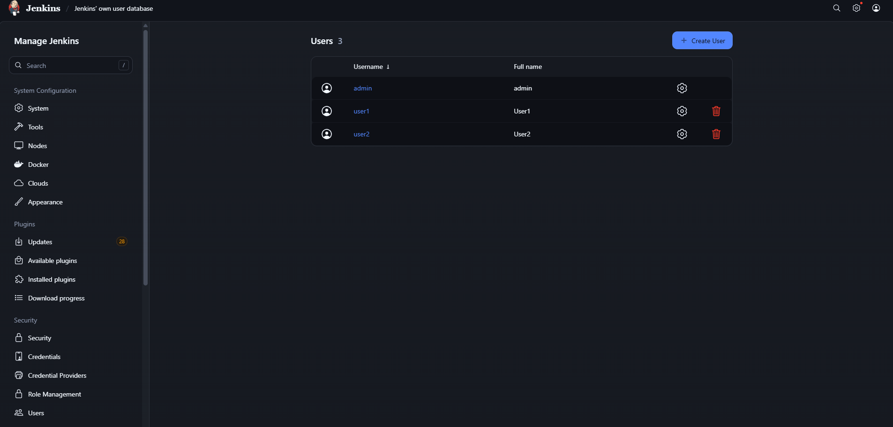
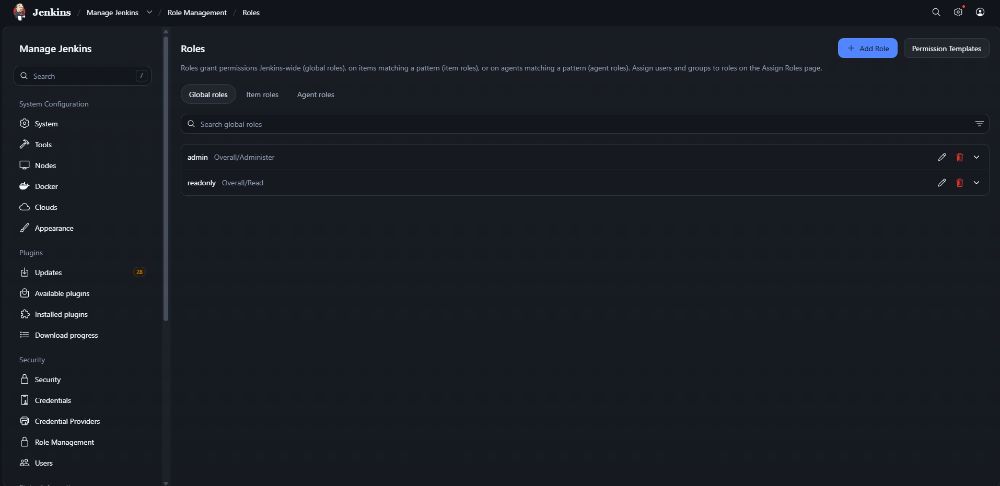
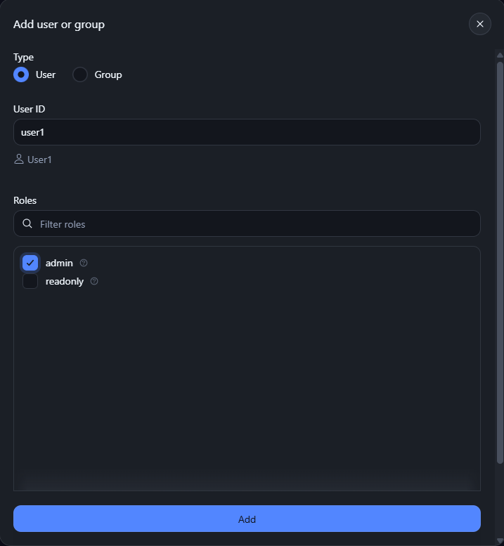

# Lab 20: Role-Based Authorization in Jenkins

### 1) Create Users in Jenkins (user1 & user2)
Navigate to **Manage Jenkins > Users** and click **Create User** to add:
- **`user1`** (Full Name: `User1`)
- **`user2`** (Full Name: `User2`)

Verify that both users appear in the user database along with the initial `admin` user:

---

### 2) Enable Role-Based Authorization Strategy
1. Install the **Role-based Authorization Strategy** (`role-strategy`) plugin from **Manage Jenkins > Plugins**.
2. Navigate to **Manage Jenkins > Security**.
3. Under **Authorization**, select **Role-Based Strategy** and save changes.

---

### 3) Define Roles in Role Management
Navigate to **Manage Jenkins > Role Management > Roles** and configure the Global Roles:
- **`admin`**: Full administrative access (`Overall/Administer`).
- **`readonly`**: View-only access (`Overall/Read`).

---

### 4) Assign Roles to Users

#### Assign Admin Role to `user1`
Navigate to **Manage Jenkins > Role Management > Assign Roles**:
1. Click **Add** under **Global roles**.
2. Enter User ID `user1`.
3. Check the **`admin`** role checkbox and confirm.

#### Assign Read-Only Role to `user2`
1. Click **Add** under **Global roles**.
2. Enter User ID `user2`.
3. Check the **`readonly`** role checkbox and confirm.

---

### 5) Verification
- Log in as **`user1`**: Verify access to **Manage Jenkins**, job creation, and system configuration.
- Log in as **`user2`**: Verify that access is strictly read-only, without permissions to create jobs, edit configurations, or access administrative management options.
