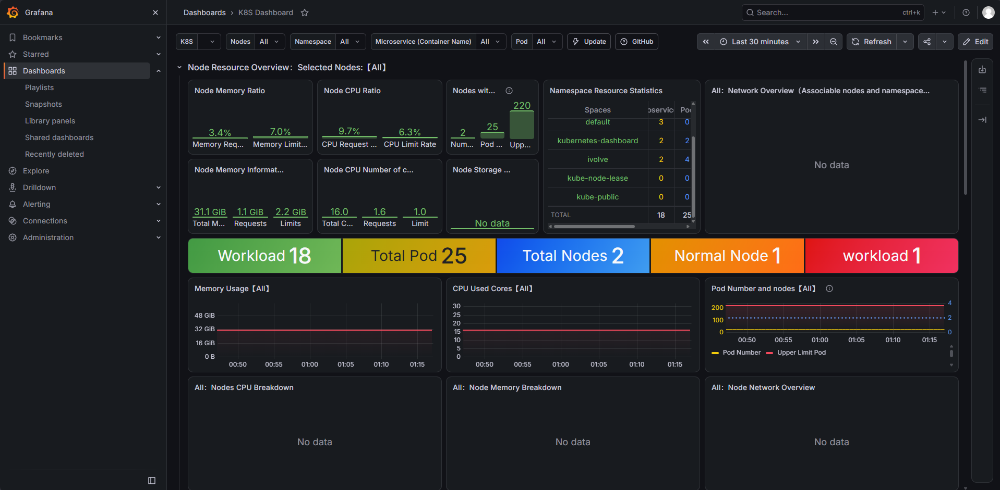

# Lab 18: Node-Wide Pod Management with DaemonSet and Monitoring Stack

### 1) Create Monitoring Namespace
Create the `monitoring` namespace to isolate monitoring resources:
```bash
kubectl create namespace monitoring
```

---

### 2) Deploy Monitoring Stack (Prometheus, Alertmanager, Grafana, Node-Exporter) Using Helm
Add the `prometheus-community` Helm repository and update chart indexes:
```bash
helm repo add prometheus-community https://prometheus-community.github.io/helm-charts && helm repo update
```

Install the `kube-prometheus-stack` chart, which deploys Prometheus, Alertmanager, Grafana, and the Prometheus Node-Exporter DaemonSet:
```bash
helm install prometheus prometheus-community/kube-prometheus-stack -n monitoring
```

Verify that all stack components are deployed and running:
```bash
kubectl get pods -n monitoring
```
```
NAME                                                         READY   STATUS    RESTARTS   AGE
alertmanager-prometheus-kube-prometheus-alertmanager-0       2/2     Running   0          4h
prometheus-grafana-9f5db4bbb-5ndcp                           3/3     Running   0          4h
prometheus-kube-prometheus-operator-785b55c6b9-mt6jm         1/1     Running   0          4h
prometheus-kube-state-metrics-599975f55f-wsdn4               1/1     Running   1          4h
prometheus-prometheus-kube-prometheus-prometheus-0           2/2     Running   0          4h
prometheus-prometheus-node-exporter-sgslb                    1/1     Running   0          4h
prometheus-prometheus-node-exporter-zngdv                    1/1     Running   0          4h
```

---

### 3) Validate Node-Exporter DaemonSet Scheduling
Verify that the `prometheus-prometheus-node-exporter` DaemonSet is created and healthy:
```bash
kubectl get daemonset prometheus-prometheus-node-exporter -n monitoring -o wide
```
```
NAME                                  DESIRED   CURRENT   READY   UP-TO-DATE   AVAILABLE   NODE SELECTOR            AGE   CONTAINERS      IMAGES                                                SELECTOR
prometheus-prometheus-node-exporter   2         2         2       2            2           kubernetes.io/os=linux   4h    node-exporter   quay.io/prometheus/node-exporter:v1.12.1-distroless   app.kubernetes.io/instance=prometheus,app.kubernetes.io/name=prometheus-node-exporter
```

Verify that a `node-exporter` pod is scheduled on every cluster node:
```bash
kubectl get pods -n monitoring -l app.kubernetes.io/name=prometheus-node-exporter -o wide
```
```
NAME                                        READY   STATUS    RESTARTS   AGE   IP             NODE           NOMINATED NODE   READINESS GATES
prometheus-prometheus-node-exporter-sgslb   1/1     Running   0          4h    192.168.49.3   minikube-m02   <none>           <none>
prometheus-prometheus-node-exporter-zngdv   1/1     Running   0          4h    192.168.49.2   minikube       <none>           <none>
```

---

### 4) Confirm Metrics Exposure via Node-Exporter Endpoints
Verify that node metrics are correctly exposed at `<node_IP>:9100/metrics` by querying the node-exporter endpoints:
```bash
kubectl exec -it -n ivolve network -- curl -s http://192.168.49.2:9100/metrics | head -n 10
```
```
# HELP go_gc_duration_seconds A summary of the wall-time pause (stop-the-world) duration in garbage collection cycles.
# TYPE go_gc_duration_seconds summary
go_gc_duration_seconds{quantile="0"} 4.7913e-05
go_gc_duration_seconds{quantile="0.25"} 7.1724e-05
go_gc_duration_seconds{quantile="0.5"} 9.5395e-05
go_gc_duration_seconds{quantile="0.75"} 0.000140165
go_gc_duration_seconds{quantile="1"} 0.078059419
go_gc_duration_seconds_sum 2.514419641
go_gc_duration_seconds_count 1219
# HELP go_gc_gogc_percent Heap size target percentage configured by the user, otherwise 100. This value is set by the GOGC environment variable, and the runtime/debug.SetGCPercent function. Sourced from /gc/gogc:percent.
# TYPE go_gc_gogc_percent gauge
```

---

### 5) Access Grafana Dashboard for Kubernetes
Retrieve the default admin password for Grafana:
```bash
kubectl get secret -n monitoring prometheus-grafana -o jsonpath="{.data.admin-password}" | base64 --decode && echo ""
```

Port-forward the Grafana service to access the UI locally:
```bash
kubectl port-forward -n monitoring svc/prometheus-grafana 3000:80
```

Access Grafana at `http://localhost:3000` (User: `admin`), navigate to **Dashboards > K8S Dashboard**, and observe cluster, node, and workload metrics:


