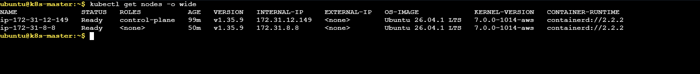
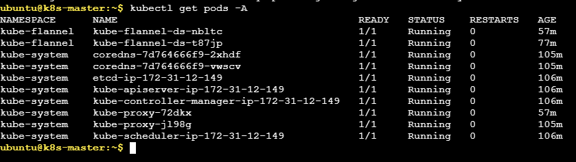

# Lab 9: Deploy Kubernetes Cluster Using Kubeadm

### 1) Prerequisites (All Nodes)
Disable swap, load required kernel modules (`overlay`, `br_netfilter`), and apply network sysctl settings:
```bash
sudo swapoff -a && sudo sed -i '/ swap / s/^/#/' /etc/fstab
```
```bash
echo -e "overlay\nbr_netfilter" | sudo tee /etc/modules-load.d/k8s.conf && sudo modprobe overlay && sudo modprobe br_netfilter
```
```bash
echo -e "net.bridge.bridge-nf-call-iptables  = 1\nnet.bridge.bridge-nf-call-ip6tables = 1\nnet.ipv4.ip_forward                 = 1" | sudo tee /etc/sysctl.d/k8s.conf && sudo sysctl --system
```

### 2) Install and Configure Container Runtime (All Nodes)
Install `containerd`, generate the default configuration, set `SystemdCgroup = true`, and enable the service:
```bash
sudo apt-get update && sudo apt-get install -y containerd
```
```bash
sudo mkdir -p /etc/containerd && containerd config default | sudo tee /etc/containerd/config.toml > /dev/null
```
```bash
sudo sed -i 's/SystemdCgroup = false/SystemdCgroup = true/' /etc/containerd/config.toml
```
```bash
sudo systemctl restart containerd && sudo systemctl enable containerd
```

### 3) Install Kubeadm, Kubelet, and Kubectl (All Nodes)
Configure the official Kubernetes apt repository, install packages, and hold versions:
```bash
sudo apt-get update && sudo apt-get install -y apt-transport-https ca-certificates curl gpg
```
```bash
sudo mkdir -p -m 755 /etc/apt/keyrings && curl -fsSL https://pkgs.k8s.io/core:/stable:/v1.31/deb/Release.key | sudo gpg --dearmor -o /etc/apt/keyrings/kubernetes-apt-keyring.gpg
```
```bash
echo 'deb [signed-by=/etc/apt/keyrings/kubernetes-apt-keyring.gpg] https://pkgs.k8s.io/core:/stable:/v1.31/deb/ /' | sudo tee /etc/apt/sources.list.d/kubernetes.list
```
```bash
sudo apt-get update && sudo apt-get install -y kubelet kubeadm kubectl && sudo apt-mark hold kubelet kubeadm kubectl
```
```bash
sudo systemctl enable --now kubelet
```

### 4) Initialize Control Plane (Control Plane Only)
Initialize the Kubernetes control plane with the Flannel Pod network CIDR:
```bash
sudo kubeadm init --pod-network-cidr=10.244.0.0/16
```

Configure `kubectl` access for the regular user:
```bash
mkdir -p $HOME/.kube && sudo cp -i /etc/kubernetes/admin.conf $HOME/.kube/config && sudo chown $(id -u):$(id -g) $HOME/.kube/config
```

### 5) Install Flannel CNI Network Plugin (Control Plane Only)
Deploy Flannel to enable pod networking across the cluster:
```bash
kubectl apply -f https://github.com/flannel-io/flannel/releases/latest/download/kube-flannel.yml
```

### 6) Join Worker Nodes to Cluster (Worker Nodes Only)
Join worker node(s) to the control plane using the token and certificate hash:
```bash
sudo kubeadm join 172.31.12.149:6443 --token 9qtuph.w410j1ioz4jtxlcb --discovery-token-ca-cert-hash sha256:412a95182538e516e83237ad16fd1e698b58ae0b1303e92f6628504cf9e41c5e 
```

*(Optional) Generate a new join command if the initial token expired:*
```bash
kubeadm token create --print-join-command
```

### 7) Verification
Verify that all cluster nodes are in `Ready` status:
```bash
kubectl get nodes -o wide
```
```
NAME               STATUS   ROLES           AGE   VERSION   INTERNAL-IP     EXTERNAL-IP   OS-IMAGE             KERNEL-VERSION   CONTAINER-RUNTIME
ip-172-31-12-149   Ready    control-plane   99m   v1.35.9   172.31.12.149   <none>        Ubuntu 26.04.1 LTS   7.0.0-1014-aws   containerd://2.2.2
ip-172-31-8-8      Ready    <none>          50m   v1.35.9   172.31.8.8      <none>        Ubuntu 26.04.1 LTS   7.0.0-1014-aws   containerd://2.2.2
```



Verify all pods across all namespaces are running:
```bash
kubectl get pods -A
```
```
NAMESPACE      NAME                                       READY   STATUS    RESTARTS   AGE
kube-flannel   kube-flannel-ds-nbltc                      1/1     Running   0          57m
kube-flannel   kube-flannel-ds-t87jp                      1/1     Running   0          77m
kube-system    coredns-7d764666f9-2xhdf                   1/1     Running   0          105m
kube-system    coredns-7d764666f9-vwscv                   1/1     Running   0          105m
kube-system    etcd-ip-172-31-12-149                      1/1     Running   0          106m
kube-system    kube-apiserver-ip-172-31-12-149            1/1     Running   0          106m
kube-system    kube-controller-manager-ip-172-31-12-149   1/1     Running   0          106m
kube-system    kube-proxy-72dkx                           1/1     Running   0          57m
kube-system    kube-proxy-jl98g                           1/1     Running   0          57m
kube-system    kube-scheduler-ip-172-31-12-149            1/1     Running   0          106m
```


